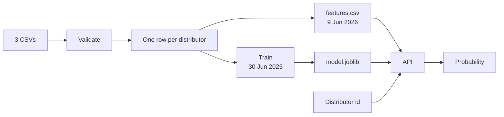

# Distributor credit risk service

Scores a distributor before a new order is approved. Raw CSVs go in, a risk probability comes out of the API.

## How it fits together



Training runs once and writes the model. The API only reads `features.csv` and that model. A request sends a distributor id, the API finds the row, and the id itself is not given to the model.

`docker build` does the left side. `docker run` starts the API.

## Build, run, test

Local, from the repo root. Python 3.11.

```bash
python3.11 -m venv .venv
.venv/bin/pip install -r requirements.txt pytest httpx
PYTHONPATH=src .venv/bin/python -m risk.pipeline
PYTHONPATH=src .venv/bin/python -m risk.train
PYTHONPATH=src .venv/bin/uvicorn risk.api:app --port 8000
```

`pipeline` writes `artifacts/features.csv`. `train` writes `artifacts/model.joblib` and `artifacts/model_meta.json`. The API will not score until both exist.

Tests:

```bash
.venv/bin/pytest
```

Docker, on a machine that has Docker and nothing else. The image trains itself during the build, so the model does not need to be in the repo.

```bash
docker build -t credit-risk .
docker run --rm -p 8000:8000 credit-risk
```

`GET /ready` is the container health check. `GET /health` only means the process is up.

Try it:

```bash
curl localhost:8000/distributors/DIST-001/risk
curl localhost:8000/portfolio/summary
curl -X POST localhost:8000/feedback \
  -H 'content-type: application/json' \
  -d '{"distributor_id": "DIST-001", "decision": "approved"}'
```

## What high_risk means

Features are computed as of 30 Jun 2025. The label looks only at invoices issued after that date and due by 9 Jun 2026.

A distributor is `high_risk` if any of those invoices was written off, or was still not fully paid on 9 Jun 2026. A partial payment counts, because money is still owed. Distributors with no invoice in that window are not in the training set. That is 86 distributors, 21 of them high risk.

The cutoff exists so the label is not built from the same invoices as the features. In this data the signal is mostly persistence: 17 of the 21 were already past due at the cutoff.

## Model

Logistic regression. Missing numbers are filled with the median, `region` and `channel` become yes/no columns, and the class weight is balanced because only about a quarter of the rows are high risk.

A depth-3 decision tree scored a higher ROC-AUC on the holdout (0.88 against 0.78). The holdout is 22 distributors, 5 of them high risk, which is too small to trust that gap. Logistic regression stays because the coefficients can be read. The largest is `n_past_due`.

Held-out result at the chosen threshold: recall 0.80, precision 0.50, ROC-AUC 0.78.

## False negatives and false positives

A false negative approves a distributor who then does not pay. The loss is the unpaid invoice. A false positive blocks a distributor who would have paid. The loss is the sale. The unpaid invoice costs more, so the threshold is 0.38, the highest cutoff that still catches about 80% of the high-risk distributors in training. The saved model is refit on all 86 labeled rows after that holdout was scored.

## Assumptions

- "Today" is 9 Jun 2026, the last order date in the files. The real calendar date is later, and using it would make every open invoice look months overdue.
- A blank `payment_date` on an overdue invoice means they have not paid. The row is kept.
- Orders and invoices dated before onboarding are kept and flagged. Tenure uses the earliest of onboarding, first order, and first invoice.
- `DIST-015` has a credit limit of 0. They are scored. Utilisation is left blank.
- `DIST-045`'s invoices use a 30-day gap against a 21-day contract. Lateness uses the due date on the invoice.
- Payments dated after 9 Jun 2026 count as unpaid.
- Payments have no `order_id`, so orders and invoices are separate signals.
- The distributor number is not a feature. Risk rises with the id, so a split that follows id order would be cheating.
- A distributor with no orders and no payments gets no score. The API says so instead of inventing one.
- The API scores the 9 Jun 2026 snapshot. That snapshot already includes the invoices the label was defined on, so a live probability is not the same thing as the training-time probability.

## With more time

- Rebuild the label on a stricter outcome, such as 60 days past due, and check it is not just "already overdue".
- Calibrate the probabilities. 1.0 for a distributor who is already deep in arrears is not a useful confidence.
- Cap `max_days_past_due`. Some open invoices are 600 days late and dominate that feature.
- Do not drop a distributor's whole history when one field on the distributor row is bad.
- Add an endpoint that scores a proposed new order, not only the distributor as they stand.
